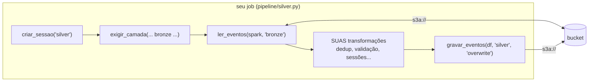
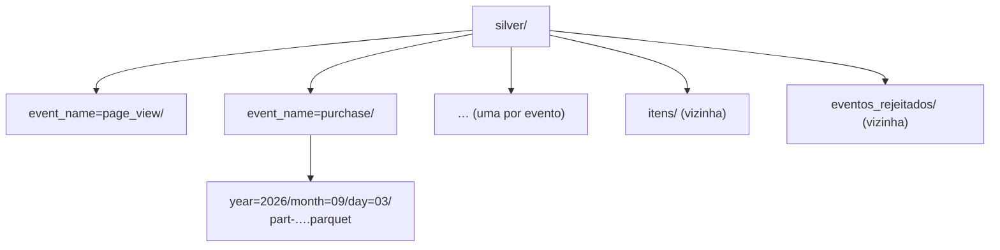
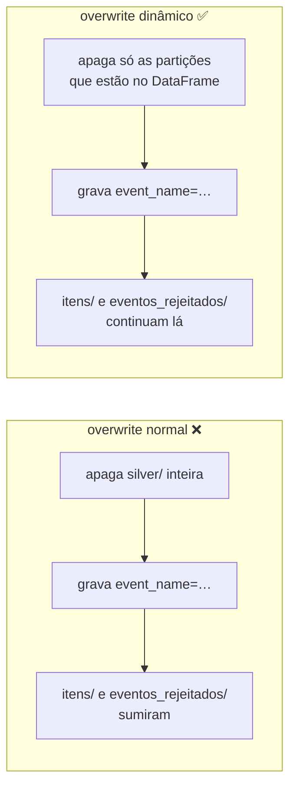

# pipeline/ — o seu datalake

Seu código vai aqui: um job por camada, como pede o [enunciado](../docs/ENUNCIADO.md) (R1 a R11).

Um **job** é um script Python que faz uma etapa do trabalho do começo ao fim: lê uma camada, transforma os dados e grava a camada seguinte. Por exemplo, o job Bronze lê a `landing/` e grava a `bronze/`.

## Como rodar um job

Todo código Python roda no contêiner `app`, que já tem PySpark 4.2.0 e o conector `s3a`:

```bash
docker compose run --rm app python pipeline/<seu_job>.py
```

Troque `<seu_job>` pelo nome do seu arquivo. Se você nunca usou Docker, o [SETUP.md](../SETUP.md) explica o que cada parte desse comando faz.

Outra forma: abra o explorador (http://localhost:8501) e vá em **Glue · Jobs ETL**. Como no Glue, os jobs do console moram no S3 (no bucket `glue-assets` do floci): clique primeiro em **⟳ Sincronizar** para enviar os seus `.py` de `pipeline/` para lá, depois escolha o job e clique em **Executar**. Ele roda a cópia do floci e mostra o status (**Sucesso** ou **Falhou**), a duração e o log. Mudou o arquivo? Sincronize de novo. Veja [explorador/README.md](../explorador/README.md#glue--jobs-etl).

Para rodar **vários jobs de uma vez**, na ordem certa, monte um workflow em **Glue · Workflows**: você escolhe os jobs e diz de quem cada um depende (a Silver depende da Bronze, as Golds dependem da Silver…). Ele fica salvo no floci (`s3://glue-assets/workflows/<nome>.json`) e numa cópia em `pipeline/workflows/<nome>.json`, e a cópia local também roda pelo terminal:

```bash
docker compose run --rm app python -m explorador.workflows pipeline/workflows/<nome>.json
```

Veja [explorador/README.md](../explorador/README.md#glue--workflows).

## Falando com o S3

O pipeline acessa o bucket **só pelo Spark**, com caminhos `s3a://datalake-tracking/...`. Nada de `boto3` aqui.

- `s3a://` é o prefixo que diz ao Spark "este caminho está num S3". É o conector `s3a` (biblioteca `hadoop-aws`) que faz a conversa com o floci.
- `boto3` é o SDK da AWS para Python. O gerador usa `boto3`, mas o seu pipeline não pode usar (requisito R1).

> **Pense assim:** `s3a://datalake-tracking/silver/` é um **endereço com CEP**: o `s3a://` diz "isto fica no S3", `datalake-tracking` é a cidade (o bucket) e o resto é a rua e o número (a pasta). O conector `s3a` é o carteiro que sabe entregar nesse endereço.

## `comum.py`: as peças prontas

A parte repetitiva já vem pronta em [`comum.py`](comum.py), nesta mesma pasta. **Não reescreva:** importe. Como os seus jobs rodam como `python pipeline/<job>.py`, o Python já encontra o `comum.py` ao lado deles.

| Função | Para que serve |
| --- | --- |
| `criar_sessao("bronze")` | a `SparkSession` configurada para o floci (s3a) e para manter `month=09` com dois dígitos. A `SparkSession` é o objeto de entrada do Spark: todo `spark.read` e todo `df.write` passam por ela |
| `caminho("silver/itens")` | `s3a://datalake-tracking/silver/itens`. Para outro bucket do floci: `caminho("notas", bucket="rascunho-turma")` dá `s3a://rascunho-turma/notas` (a mesma `SparkSession` lê e grava em qualquer bucket) |
| `glob_eventos("bronze")` | `bronze/event_name=*`: só as pastas de eventos da camada |
| `ler_eventos(spark, "bronze")` | lê as pastas `event_name=…` da camada, com `event_name`, `year`, `month` e `day` como colunas. Para a landing: `ler_eventos(spark, "landing", "json", schema=SEU_SCHEMA)` |
| `gravar_eventos(df, "silver", "overwrite")` | grava particionado por `event_name/year/month/day` na raiz da camada, sem apagar as pastas vizinhas |
| `exigir_camada(spark, glob_eventos("bronze"), "python pipeline/bronze.py")` | para o job com "… não existe. Rode antes: …" se a camada anterior não existe (R2) |
| `apagar_camada(spark, "gold")` | apaga a pasta inteira, para recomeçar do zero |
| `titulo("Bronze")` | imprime um título destacado na saída |
| `arquivo_do_projeto("site/mapa_calor.js")` | um arquivo do repositório, fora do S3 (`/projeto/site/mapa_calor.js`). Funciona igual no terminal e no explorador |

Um job Bronze fica assim:

```python
from comum import criar_sessao, exigir_camada, glob_eventos, gravar_eventos, ler_eventos, titulo

SCHEMA = ...   # o schema explícito da landing (R4): escreva o seu

spark = criar_sessao("bronze")
exigir_camada(spark, glob_eventos("landing"), "python gerador/gerar_eventos.py")
landing = ler_eventos(spark, "landing", "json", schema=SCHEMA)
bronze = ...   # proveniência e partições year/month/day (R4): é aqui que está o seu trabalho
gravar_eventos(bronze, "bronze", "append")
titulo("Bronze")
spark.stop()
```

O `comum.py` usa só o Spark (R1). As seções abaixo explicam o que ele faz por baixo, para você entender e conseguir depurar.

> **Pense assim:** a `SparkSession` é a **chave da cozinha**: sem ela, nada se lê nem se grava. O `comum.py` é a **caixa de ferramentas** que vem com a cozinha: em vez de forjar uma faca nova a cada receita, você pega a que já está afiada e gasta o tempo cozinhando.



Só a caixa do meio é trabalho seu; as outras são uma linha cada, vindas do `comum.py`.

### Como `exigir_camada` confere se uma camada existe

Ele usa o `FileSystem` do Hadoop pela JVM do Spark:

```python
caminho = spark._jvm.org.apache.hadoop.fs.Path("s3a://datalake-tracking/silver/event_name=*")
existe = bool(caminho.getFileSystem(spark._jsc.hadoopConfiguration()).globStatus(caminho))
```

O `*` é um **glob**, um "curinga": `event_name=*` casa com qualquer pasta que comece com `event_name=`. Por isso o trecho usa `globStatus` (que entende curingas) em vez de `exists`.

> **Pense assim:** é o **coringa do baralho**, que vale qualquer carta. `event_name=*` vale `event_name=scroll`, `event_name=purchase` e todas as outras.

## Partições por nome do evento e por dia

Uma **partição** é uma subpasta que agrupa os dados por um valor. Aqui há dois níveis: primeiro o nome do evento, depois o dia. Todas as rolagens de 3 de setembro de 2026 ficam em `event_name=scroll/year=2026/month=09/day=03/`. Assim, quem quer ler só as compras, ou só um dia, não precisa abrir o resto.

> **Pense assim:** as partições são **gavetas etiquetadas** num arquivo de aço. A etiqueta da gaveta é o nome do evento; dentro dela, uma pasta por ano, mês e dia. Para achar as compras de 3 de setembro, você abre uma gaveta e uma pasta, e não o arquivo inteiro.

A landing, a Bronze e a Silver guardam os eventos assim, **direto na raiz da camada** (não existe pasta `eventos`):

```text
landing/event_name=scroll/year=2026/month=09/day=03/coletor-s42-001.jsonl
bronze/event_name=scroll/year=2026/month=09/day=03/part-….parquet
silver/event_name=scroll/year=2026/month=09/day=03/part-….parquet
silver/itens/year=2026/month=09/day=03/part-….parquet      ← vizinha das pastas event_name=
silver/eventos_rejeitados/part-….parquet                   ← vizinha também
```



Na raiz da Silver convivem dois tipos de pasta: as partições de eventos (`event_name=…`) e as vizinhas (`itens/`, `eventos_rejeitados/`). É por isso que ler e gravar a raiz exige os cuidados abaixo.

### Os dois dígitos do mês

Ao ler pastas `k=v`, o Spark descobre `event_name`, `year`, `month` e `day` como colunas e, por padrão, converte os valores que parecem número: `month=09` vira `9`, e ao regravar sai `month=9`. Para manter tudo como texto, desligue essa inferência na `SparkSession`:

```python
.config("spark.sql.sources.partitionColumnTypeInference.enabled", "false")
```

### Ler só os eventos (o que `ler_eventos` faz)

Se você ler a raiz `s3a://datalake-tracking/silver/` direto, o Spark encontra `event_name=…` ao lado de `itens/` e `eventos_rejeitados/` e para com o erro *Conflicting directory structures*. Leia só as pastas `event_name=` com um glob e diga ao Spark onde fica a raiz das partições (`basePath`), para ele devolver `event_name` como coluna:

```python
raiz = "s3a://datalake-tracking/silver"
eventos = spark.read.option("basePath", raiz).parquet(f"{raiz}/event_name=*")
```

A landing é igual, com `.json(...)` no lugar de `.parquet(...)`. O `event_name` que vem do caminho é o mesmo que está dentro de cada evento.

> **Pense assim:** o `basePath` diz ao Spark **a partir de qual gaveta começar a contar**. Sem ele, o Spark acha que `event_name=scroll` é só o nome de uma pasta qualquer; com ele, entende que `event_name` é uma coluna e `scroll` é o valor dela.

### Gravar sem apagar as vizinhas (o que `gravar_eventos` faz)

Na gravação, use `.partitionBy("event_name", "year", "month", "day")` com as quatro colunas como texto. O `partitionBy` cria uma subpasta por combinação de valores dessas colunas.

Cuidado com o `mode("overwrite")` na Silver: por padrão ele **apaga a pasta inteira** antes de gravar, e `silver/` inteira inclui `itens/` e `eventos_rejeitados/`. Use o modo **dinâmico**, que troca só as partições que estão no DataFrame:

```python
(silver.write.mode("overwrite")
    .option("partitionOverwriteMode", "dynamic")
    .partitionBy("event_name", "year", "month", "day")
    .parquet("s3a://datalake-tracking/silver"))
```

Na Bronze, que é append-only (R4), use `mode("append")` com o mesmo `partitionBy`.

> **Pense assim:** o `overwrite` normal **esvazia o armário inteiro** para guardar as roupas novas, inclusive as gavetas que você nem ia mexer (`itens/`, `eventos_rejeitados/`). O modo dinâmico **troca só as gavetas que mudaram** e deixa o resto onde estava.



## Spark 4: erro em vez de `null` (modo ANSI)

O projeto usa o PySpark 4.2, que liga o **modo ANSI** por padrão. Nele, uma conta impossível **para o job com erro**, em vez de devolver `null` como no Spark 3:

- dividir por zero: `F.col("compras") / F.col("sessoes")` com `sessoes = 0` dá `DIVIDE_BY_ZERO`;
- converter texto que não é número ou data: `F.col("valor").cast("double")` com `"abc"`, ou `F.to_timestamp(...)` com uma data mal escrita, dá `CAST_INVALID_INPUT`.

> **Pense assim:** o modo ANSI é um **caixa que confere cada nota**. Antes, uma nota falsa passava em branco (virava `null`) e você só descobria depois, no relatório. Agora o caixa para a fila e avisa na hora. É mais seguro, mas, quando você **sabe** que o dado pode vir sujo e quer o `null`, precisa dizer isso.

Quando o `null` é o que você quer, use as funções `try_`:

| Em vez de | Use | O que acontece com o dado ruim |
| --- | --- | --- |
| `a / b` | `F.try_divide(a, b)` | `null` quando `b` é zero |
| `F.col("x").cast("double")` | `F.col("x").try_cast("double")` | `null` quando `x` não é número |
| `F.to_timestamp("ts", formato)` | `F.try_to_timestamp("ts", F.lit(formato))` | `null` quando a data não segue o formato |

Na Silver, isso é útil para **rejeitar** o dado sujo: converta com `try_`, e o que virou `null` vai para os rejeitados com o motivo. Na Gold, use `F.try_divide` nas taxas cujo denominador pode ser zero.

## Antes de começar

Rode estes três comandos, nesta ordem:

1. `docker compose up -d floci` (liga o S3 local)
2. `docker compose run --rm app python gerador/gerar_eventos.py` (grava os eventos na landing)
3. `docker compose run --rm app python infra/verificar_ambiente.py`, que precisa mostrar três linhas `[ok]`

## Exportar um resultado pequeno para o site

O requisito R11 pede um arquivo `site/mapa_calor.js` com os números do mapa de calor. Esse arquivo não fica no S3: o site lê do disco. Então o job lê a Gold pelo Spark e, no fim, grava um arquivo comum com Python.

- **Trazer o resultado para o Python:** `collect()` traz as linhas de um DataFrame do Spark para uma lista do Python. Use só com tabelas pequenas, como as duas do mapa de calor, que têm poucas dezenas de linhas. **Nunca** faça isso com a Bronze ou a Silver: são dezenas de milhares de linhas e o job fica lento ou estoura a memória.

  > **Pense assim:** o Spark é um **armazém** com muitos funcionários trabalhando em paralelo; o Python do seu script é a **sua mesa**. O `collect()` traz tudo do armazém para a sua mesa. Um envelope com 30 linhas cabe; um caminhão com 60 mil, não.
- **Onde gravar:** o contêiner enxerga o repositório em `/projeto`, então `site/` é `/projeto/site/`. Use `arquivo_do_projeto("site/mapa_calor.js")`, do `comum.py`: ele parte da pasta do projeto, que é sempre a pasta atual quando um job roda. Não use `Path(__file__)`: no explorador, o script roda de uma cópia baixada do floci, numa pasta temporária, e o `__file__` aponta para lá.

```python
import json
from datetime import datetime, timezone
from comum import arquivo_do_projeto

cliques = [linha.asDict() for linha in spark.read.parquet("s3a://datalake-tracking/gold/mapa_calor_cliques").collect()]
rolagem = [linha.asDict() for linha in spark.read.parquet("s3a://datalake-tracking/gold/mapa_calor_rolagem").collect()]
agora = datetime.now(timezone.utc).strftime("%Y-%m-%dT%H:%M:%SZ")
dados = {"gerado_em": agora, "cliques": cliques, "rolagem": rolagem}

destino = arquivo_do_projeto("site/mapa_calor.js")
texto = json.dumps(dados, ensure_ascii=False, default=float)
destino.write_text("window.MAPA_CALOR = " + texto + ";\n", encoding="utf-8")
```

- `default=float` cuida das colunas do tipo `Decimal` (por exemplo, quando você usa `cast("decimal(…)")`): o `json.dumps` não sabe escrever `Decimal` e daria `TypeError`. Prefira gravar as taxas da Gold como `double`.
- Se o mapa sair sem cliques, a sua landing provavelmente foi gerada antes do campo `element_id` existir. Rode de novo `python gerador/gerar_eventos.py` e o pipeline inteiro.

Depois, abra `site/index.html` no navegador e clique em **Mapa de calor**, no painel lateral. Se você rodar o job de novo, recarregue a página para ver os números novos.

## O pipeline construído

### `bronze.py` — ingestão (R1, R2, R4)

O job Bronze lê os eventos brutos da `landing/` e os grava, fiéis, na camada
`bronze/`. É a primeira etapa do medalhão e **não limpa nada** — toda a limpeza
(deduplicação, validação, rejeições) é da Silver.

```bash
docker compose run --rm app python pipeline/bronze.py
```

**Pré-requisito:** a landing precisa existir. Se não existir, o job para com a
mensagem `… não existe. Rode antes: python gerador/gerar_eventos.py` (R2, via
`exigir_camada`).

O que o job faz:

- **Schema explícito (R4), sem inferência**, compatível com
  [`docs/CONTRATO_EVENTO.md`](../docs/CONTRATO_EVENTO.md): os campos simples
  (`event_id`, `event_ts`, `user_pseudo_id`, `user_id`, `session_hint`), os
  objetos aninhados `page`, `traffic` e `device` (`struct`), a lista `items`
  (`array<struct>`) e `params` em **duas colunas**.
  - `params` é guardado de duas formas, derivadas de uma única leitura (o schema
    lê `params` como texto):
    - **`params_json`** (string): o objeto JSON de `params` preservando os tipos
      (número, booleano, nulo), o aninhamento e as chaves inesperadas. É a cópia
      fiel (R4) — nada se perde nem se inventa.
    - **`params`** (`map<string,string>`): derivado de `params_json` com
      `from_json`, para consultar as chaves no explorador e alimentar a Silver.
    A tipagem por chave é a **R6 (Silver)**. A decisão (e as alternativas testadas,
    inclusive `VariantType`) está em
    [`entregas/01_bronze/evidencias/05_decisao_params.md`](../entregas/01_bronze/evidencias/05_decisao_params.md).
    Limite: o Spark pode normalizar o espaçamento do JSON em `params_json`; o
    conteúdo e os tipos são fiéis.
  - `event_ts` fica como **texto** na Bronze: o evento pode vir com timestamp nulo
    ou no futuro (defeitos injetados), e converter aqui, no modo ANSI do Spark 4,
    pararia o job. A tipagem é da Silver.
  - `event_name` **não** entra no schema de leitura: vem da partição do caminho
    (mesmo valor do corpo do evento), evitando a coluna duplicada.
- **Proveniência (R4):** acrescenta `_arquivo_origem` (o arquivo da landing de
  onde a linha veio, via `input_file_name()`) e `_ingerido_em` (o instante UTC da
  ingestão, via `current_timestamp()`).
- **Gravação (R1, R4):** Parquet em `s3a://datalake-tracking/bronze/`, particionado
  por `event_name/year/month/day`, em modo **append** (append-only: nunca apaga
  nem reescreve o histórico). Usa `gravar_eventos` do `comum.py`.

Ao terminar, imprime o total de linhas desta execução, o total acumulado na
Bronze e a contagem por `event_name`.

Rodar o job de novo **acrescenta** (append): se a landing for a mesma, os eventos
reaparecem na Bronze. Remover essas duplicatas de reenvio é trabalho da Silver
(R5), não da Bronze.

Para rodar os testes do job:

```bash
docker compose run --rm app python -m pytest tests/pipeline
```

### `silver.py` — dado limpo (R5–R10)

O job Silver lê a `bronze/` e produz o dado tratado: deduplica, tipa os `params`,
valida com motivo de rejeição, reconstrói as sessões, costura a identidade e
explode os itens. Grava **três conjuntos** no prefixo `silver/`, em prefixos
disjuntos.

```bash
docker compose run --rm app python pipeline/silver.py
```

**Pré-requisito:** a Bronze precisa existir. Se não existir, o job para com a
mensagem `… não existe. Rode antes: python pipeline/bronze.py` (R2, via
`exigir_camada`).

**Entradas:** `silver.eventos` lê `bronze/` por `ler_eventos(spark, "bronze")`
(colunas `event_id`, `event_ts` texto, `user_pseudo_id`, `user_id`,
`session_hint`, structs `page`/`traffic`/`device`, `params_json`, `params`,
`items`, proveniência `_arquivo_origem`/`_ingerido_em`, e as partições
`event_name/year/month/day`).

**Saídas** (gravadas na ordem fixa rejeitados → itens → válidos):

- `silver/event_name=.../year=.../month=.../day=...` — eventos **válidos**, com as
  colunas tipadas de `params`, `event_ts_ts` (timestamp), `session_id`,
  `user_id_resolvido` e `pagina`. Gravado por `gravar_eventos(..., "silver",
  "overwrite")` (overwrite dinâmico).
- `silver/itens/year=.../month=.../day=...` — `items[]` explodido, uma linha por
  item por evento (R10). Overwrite dinâmico por `year/month/day`.
- `silver/eventos_rejeitados/` — eventos rejeitados, um motivo por linha (R7).
  Overwrite total, sem partição.

O pipeline interno segue cinco fases determinísticas, nesta ordem:

- **R5 — deduplicação por `event_id`.** `row_number()` com desempate estável
  (`_arquivo_origem → _ingerido_em → event_ts → event_id`) mantém uma cópia por
  `event_id`. Linhas sem `event_id` são separadas antes da janela e mantidas
  isoladas (não viram duplicata umas das outras). A proveniência da cópia escolhida
  é preservada.
- **R6 — tipagem dos `params`.** As chaves viram colunas tipadas a partir do
  `params_json` cru (preserva número/booleano/nulo), via `from_json` com um schema
  único de união; inclui `element_id`. `from_json`/`get_json_object` fazem *parse*
  (não cast ANSI) e não abortam; todo cast posterior usa
  `try_cast`/`try_to_timestamp`. Flags de presença (`tem_value` etc.) distinguem
  chave ausente (ausência legítima, não rejeita) de valor presente e inválido.
- **R7 — validação com motivo de rejeição.** As 6 regras mínimas do enunciado
  (evento fora do catálogo; timestamp ausente ou futuro; transação sem id; valor
  monetário inválido; marco fora do padrão; reembolso sem compra) mais duas
  acrescentadas (`valor_nao_numerico`, `marco_nao_numerico`). Dois passos: as
  regras independentes e, depois, `reembolso_sem_compra` contra o conjunto de
  `purchase` válidos. Um motivo por linha; rótulos constantes para agregação limpa.
- **R8 — sessionização.** `session_id` por corte estrito de **> 30 min** por
  `user_pseudo_id`, com window functions, ordenando por `(event_ts_ts, event_id)`.
  **Nunca** usa `session_hint`. Roda só sobre os válidos.
- **R9 — identity stitching.** `user_id_resolvido` por `user_pseudo_id`: o mapa
  `user_pseudo_id → user_id` é lido de todos os eventos pós-dedup (válidos +
  rejeitados) e aplicado aos válidos, inclusive aos eventos anteriores ao login.
- **R10 — tabela de itens.** `items[]` explodido com `F.explode` (eventos sem itens
  geram 0 linhas), cada linha vinculada ao evento de origem.

Ao terminar, o job imprime a reconciliação — `processados == válidos + duplicatas
+ rejeitados_distintos`, disjunção `válidos ∩ rejeitados`, cobertura, e as
invariantes de `silver/itens/` (`itens == Σ size(items)`, todo `event_id` de itens
existe nos válidos) — e aborta se qualquer identidade falhar.

O job é **idempotente** sobre a mesma Bronze (os três `overwrite` reescrevem as
mesmas partições, sem acúmulo) e **não altera a Bronze** (append-only). Nunca grava
na raiz `silver/` direta nem usa `apagar_camada("silver")`.

Para rodar os testes do job Silver:

```bash
docker compose run --rm app python -m pytest tests/pipeline/test_silver.py
```

### `gold_comum.py` — peças compartilhadas das Golds

Não é um job: é um módulo importado pelos jobs Gold (funil, engajamento, receita,
ML) para não reimplementar as decisões transversais do datalake. Expõe:

- `atributos_sessao(eventos)` — uma linha por `session_id` com `canal`, `plano` e
  `dispositivo`. `canal` = `coalesce(source,"") / coalesce(medium,"")` (coalesce
  **antes** do `concat_ws`, para o separador aparecer sempre); `dispositivo` =
  `device.category`; `plano` = `item_id` do **primeiro `select_item`** da sessão
  (lido de `items[0].item_id`, pois a Silver não promove `item_id` a coluna de
  topo), ou `"(nenhum)"`.
- `to_date_utc(coluna)` — a data (UTC) do evento a partir de `event_ts_ts`, nunca
  as partições `year/month/day` (que são o dia de coleta).

### Os cinco jobs Gold (R1, R2) — 15 tabelas analíticas (5.3)

Cada job lê a Silver por `ler_eventos(spark, "silver")` (e `silver/itens` quando
precisa), chama `exigir_camada(..., "python pipeline/silver.py")`, e grava **cada
tabela** com `df.write.mode("overwrite").parquet(comum.caminho("gold/<tabela>"))`
— **sem partição**, uma pasta por tabela em `gold/`. Taxas com denominador que
pode ser zero usam `F.try_divide`. O join `purchase → silver/itens` é sempre por
`event_id`.

| Job | Tabelas geradas |
| --- | --- |
| `gold_funil.py` | `funil_compra`, `funil_lead` |
| `gold_engajamento.py` | `sessoes`, `retencao_video`, `buscas_faq`, `saidas_downloads` |
| `gold_receita_aquisicao.py` | `receita_diaria`, `taxa_reembolso`, `adesao_order_bump`, `lead_para_compra` |
| `gold_ml.py` | `propensao_sessao`, `metricas_modelo`, `segmentos_visitantes` (+ `segmentos_perfil`) |
| `gold_mapa_calor.py` | `mapa_calor_cliques`, `mapa_calor_rolagem` |

```bash
docker compose run --rm app python pipeline/gold_funil.py
docker compose run --rm app python pipeline/gold_engajamento.py
docker compose run --rm app python pipeline/gold_receita_aquisicao.py
docker compose run --rm app python pipeline/gold_ml.py
docker compose run --rm app python pipeline/gold_mapa_calor.py
```

Notas por job:

- **`gold_funil.py`** — `funil_compra` tem 7 etapas
  (`view_item_list → … → purchase`) nos escopos `total` e `segmentado`
  (plano × canal), com `conv_etapa_anterior`, `conv_topo` e `taxa_view_item`
  calculada **no mesmo recorte da linha**. `funil_lead` é por canal + sentinela
  `(total)`.
- **`gold_engajamento.py`** — `retencao_video` nos marcos {10,25,50,75,100} sobre
  as sessões com `video_start`; `saidas_downloads` descarta saídas com
  `link_domain` nulo mas **nunca** descarta downloads (`file_download`/`file_name`).
- **`gold_receita_aquisicao.py`** — receita bruta = `value` do `purchase` (não soma
  itens); reembolso ligado por `transaction_id` (`refund → purchase`) e lançado na
  **data da compra** (LEFT JOIN, garante `receita_bruta ≥ receita_reembolsada`);
  order bump por `item_id='BUMP-MENTORIA'`; lead → compra por pessoa, mediana via
  `percentile_approx`.
- **`gold_ml.py`** — propensão à compra por sessão com `pyspark.ml`, features
  **estritamente pré-carrinho** (corte no 1º `add_to_cart` + lista negra dos
  eventos de checkout) para não vazar informação futura; `metricas_modelo` tem
  exatamente 4 linhas (`auc`, `f1`, `precisao`, `recall`); segmentação por KMeans
  (`segmentos_visitantes` + `segmentos_perfil`).
- **`gold_mapa_calor.py`** — `mapa_calor_cliques` e `mapa_calor_rolagem` com os
  **nomes de coluna exatos** exigidos pelo R11 (`pagina, element_id, cliques,
  sessoes, sessoes_na_pagina, taxa_clique, intensidade` e `pagina, marco,
  sessoes_que_chegaram, pct_sessoes`); `intensidade` em [0,1] (máximo 1 por página).

### `exportar_mapa_calor.py` — site/mapa_calor.js (R11)

Oitavo job. Lê `gold/mapa_calor_cliques` e `gold/mapa_calor_rolagem` pelo Spark,
traz com `collect()` (tabelas pequenas) e grava **uma linha**
`window.MAPA_CALOR = {…};` em `site/mapa_calor.js` (via `arquivo_do_projeto`, a
única escrita em disco permitida). Reexecutável; dados ausentes viram listas `[]`
válidas. Depois, abra `site/index.html` e o mapa de calor acende.

```bash
docker compose run --rm app python pipeline/exportar_mapa_calor.py
```

### `executar_pipeline.py` — orquestrador dos 8 jobs (R3)

Roda a sequência oficial, sem paralelismo, parando na primeira falha e propagando
o código de saída:

```text
bronze → silver → gold_funil → gold_engajamento → gold_receita_aquisicao →
gold_ml → gold_mapa_calor → exportar_mapa_calor
```

```bash
docker compose run --rm app python pipeline/executar_pipeline.py
```

**Bronze append-only (R3/R4).** Como a Bronze faz `append`, reexecutar a sequência
sobre uma Bronze já populada duplicaria eventos. O orquestrador trata isso com três
modos (nunca apaga histórico em silêncio):

- `--desde=auto` (padrão) — se a Bronze já existe, **pula** a ingestão Bronze e
  começa pela Silver; senão, ingere a Bronze.
- `--desde=bronze --recriar-bronze` — apaga a Bronze (`apagar_camada`) e reingere
  do zero. Só sob a flag explícita.
- `--desde=<etapa>` — começa na etapa indicada (as dependências são garantidas pelo
  `exigir_camada` de cada job).

O orquestrador **nunca** chama o gerador: a landing é pré-condição. Importa os
módulos e chama `main()` de cada um no mesmo processo, medindo tempo e registrando
início/fim/resultado por etapa.

Para rodar toda a suíte de testes do pipeline:

```bash
docker compose run --rm app python -m pytest
```
